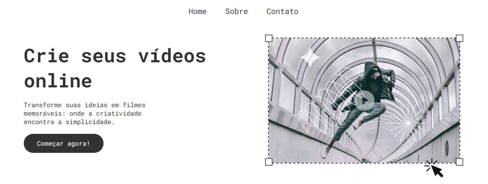

# Plataforma de Vídeos · Web Development

| Integrante | RM |
|---|---|
| [Guilherme Santos Nunes](https://github.com/sannunez) | RM558989 |
| [Kaique Zaffarani](https://github.com/Z4ffarani) | RM556677 |
| [Kairo da Silva Silvestre de Carvalho](https://github.com/KairoSilvestre) | RM558288 |
| [Rafael Menezes Viana](https://github.com/vianafs) | — |

Checkpoint 1 · 2024.2 · Engenharia de Software · FIAP

---

## Esta entrega: Web Development

O projeto **Plataforma de Vídeos** é uma aplicação web fictícia, desenvolvida para facilitar a criação e publicação de vídeos. Utilizando React.js e styled-components, o projeto inclui as páginas:
- **Home** | A página principal que introduz a plataforma e oferece um botão para começar a usar o serviço.
- **Sobre** | Detalhes sobre a plataforma e os planos de assinatura disponíveis.
- **Contato** | Formulário para dúvidas e suporte.
- **Página 404** | Mostra uma mensagem quando uma página não é encontrada.

## Prévia



## Como executar

```bash
git clone https://github.com/Z4FFARANI-EDUCATIONAL/2024-SEM2-CP1-WEB-DEVELOPMENT.git
cd 2024-SEM2-CP1-WEB-DEVELOPMENT/plataforma-videos
npm install
npm run dev
```

Depois, acesse o site em http://localhost:5173.

## Funções

| Componente | O que faz |
|---|---|
| `Header.jsx` | Componente estilizado que fornece navegação entre as páginas Home, Sobre e Contato. |
| `Home.jsx` | Exibe uma introdução ao serviço e oferece opções de criação de vídeos com links para plataformas populares. |
| `Sobre.jsx` | Apresenta informações sobre a plataforma e planos de assinatura com botões para cadastro ou contato. |
| `Contato.jsx` | Formulário para os usuários entrarem em contato com a equipe de suporte, com validação de comprimento da mensagem. |
| `PageNotFound.jsx` | Mostra uma mensagem quando a página solicitada não é encontrada. |

## Observações

- É necessária a instalação do Node.js para que o programa seja rodado.
- Certifique-se de que o arquivo `index.html` está corretamente configurado para incluir os códigos de `main.jsx`.
- Os estilos são aplicados através de arquivos CSS e componentes do styled-components. Assegure-se de que todos os arquivos de estilização estão corretamente importados.
- O roteamento é gerenciado pelo react-router-dom, então deve-se adicionar novas rotas no arquivo `main.jsx` se necessário.

---

## Tecnologias

[](https://vitejs.dev)
[](https://react.dev)
[](https://styled-components.com)
[](https://nodejs.org)
[](https://www.npmjs.com)

---

## Agradecimentos

- [Caio Vinícius Gonçalves de Oliveira](https://github.com/caiooliveira-tech)
